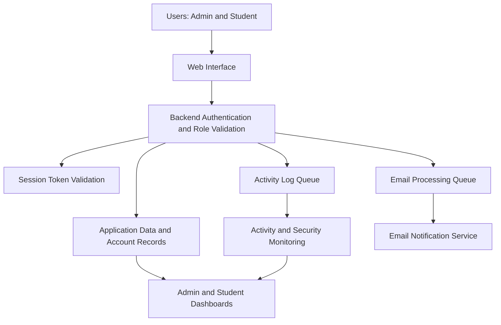

# Secure Academic Portal

### Secure Role-Based Academic Management Portal

A security-focused academic platform that brings student resources, administrative oversight, session controls, automated notifications, and usage analytics into one web application.

  <a href="https://secure-academic-portal.vercel.app/"><strong>🌐 Open Live Portal</strong></a>

**Presented by Ajay Chauhan** · BCA — Data Science & Artificial Intelligence · Babu Banarasi Das University

---

## Contents

- [Overview](#overview)
- [The Problem](#the-problem)
- [What the Portal Provides](#what-the-portal-provides)
- [System Architecture](#system-architecture)
- [Authentication and Session Lifecycle](#authentication-and-session-lifecycle)
- [Email Automation and Queue Processing](#email-automation-and-queue-processing)
- [Admin Dashboard and Analytics](#admin-dashboard-and-analytics)
- [Student Dashboard](#student-dashboard)
- [Technology Snapshot](#technology-snapshot)
- [Security Notes](#security-notes)
- [Live Deployment](#live-deployment)
- [Planned Enhancements](#planned-enhancements)
- [Project Context](#project-context)

---

## Overview

The **Secure Role-Based Academic Management Portal** is a web-based academic platform designed to centralize student resources and provide administrators with account management, security visibility, and activity monitoring.

The portal separates access for **Admin** and **Student** roles. Its current feature set combines academic-resource access with backend role validation, SHA-256-based password hashing, account-lock controls, session-token validation, automated email notifications, queue-based processing, and dashboard analytics.

The project was presented at **IBM Day** at Babu Banarasi Das University (BBDU).

## The Problem

Academic information can become difficult to manage when resources, notices, account activity, and administrative actions are spread across separate workflows. A central system should make academic resources easier to access while protecting administrative operations and providing visibility into security-related events.

This project addresses the following needs:

- One place for assignments, notes, previous-year questions, notices, and deadlines.
- Clear separation between administrator and student permissions.
- Visibility into account status and failed login activity.
- Automated registration, password-reset, and security-related email workflows.
- More reliable handling of email and activity-log work when multiple users perform actions concurrently.

## What the Portal Provides

### Admin experience

- Overview of total, active, locked, and blocked accounts.
- Failed-login tracking and login-growth comparison.
- Line and donut charts for administrative monitoring.
- Student details and account-management controls.
- Activity logs, email-send logs, and academic activity logs.
- Controls to block or unblock accounts and initiate password resets.
- Content upload and batch-wise student notifications.
- Daily registration notifications and weekly security summaries.

### Student experience

- Dashboard overview of total assignments, pending assignments, expired assignments, notes, and PYQs.
- Access to assignments, notes, previous-year questions, and announcements.
- Upcoming-deadline visibility.
- A subject/resource progress panel showing the academic items currently available in the portal.

> **Progress-panel clarification:** The current panel reflects available academic items. It should not be interpreted as marks-based performance or assignment-completion progress unless those statuses are explicitly tracked by the implementation.

## System Architecture

The portal can be understood through three logical layers. The diagram below shows the responsibilities at a high level; it does not imply a particular database vendor or queue product.

**Architecture principles**

- **Role separation:** admin and student workflows have different permissions.
- **Backend enforcement:** frontend navigation alone does not grant authorization; protected requests are validated on the backend.
- **Session awareness:** protected access depends on a valid session token.
- **Operational visibility:** account and activity indicators are surfaced in the admin dashboard.
- **Queued work:** email and activity-log tasks use queue-based processing to help handle concurrent actions reliably.

## Authentication and Session Lifecycle

### Login and account protection

1. A student registers using the required details, including roll number, name, batch, email, and password.
2. The password is processed using the project's SHA-256-based hashing flow; the implementation uses a double-hash comparison/storage mechanism.
3. During login, the submitted password is processed and checked against the stored value.
4. Five consecutive failed login attempts trigger account-lock protection.
5. Password recovery is initiated through the registered email address using a reset link.
6. Password-reset requests are limited to one request per account per day using a cache-based control.

### Session token behaviour

- A session token is generated after successful login.
- The token is required for protected backend requests and has a configured lifetime of **one hour**.
- The backend validates the token and role before allowing protected operations.
- A subsequent login replaces the previously stored token with a newly generated token, supporting a single active token per user.
- When the token expires, protected access is denied and the interface should return the user to login.

### Backend authorization

Opening or editing an admin page in the browser is not intended to grant admin privileges. The backend must validate both the session token and the role associated with the request before returning protected data or performing a privileged action.

### Password-reset safeguards

The current design includes backend-side device/session validation for reset-link use and a cache-based limit on reset requests. These controls are intended to reduce link misuse and repeated reset requests.

> **Operational note:** If a token remains valid after logout until its expiry time, immediate revocation is not guaranteed. For stronger logout semantics, explicitly invalidate the server-side token when the user logs out, and verify this behaviour in the deployed implementation.

## Email Automation and Queue Processing

### Automated notifications

The portal supports the following email workflows:

- **Student welcome email:** sent after the student's first registration.
- **Admin registration alert:** notifies the administrator when a new student registers.
- **Password-reset email:** provides the reset workflow to the registered email address.
- **Weekly security summary:** summarizes configured security activity, such as logins and password resets.
- **Academic content notifications:** informs relevant students when new content is uploaded for their batch.

### Why use queues?

Several students may register, request password resets, or perform other actions at around the same time. Queue-based processing helps separate the request from the background work and reduces the risk of conflicting writes or overwritten event data.

- Email work is queued for processing.
- Activity-log events are queued to help preserve event records under concurrent use.
- Sequential/background processing improves operational consistency and makes failures easier to inspect.

A queue alone cannot guarantee that every email reaches its recipient. A production deployment should also consider retry policies, delivery-failure handling, monitoring, and duplicate-event protection.

## Admin Dashboard and Analytics

The admin dashboard combines account indicators with visual monitoring:

| Dashboard area | Purpose |
|---|---|
| Account status | Shows total, active, locked, and blocked accounts. |
| Login monitoring | Tracks failed logins and login-growth trends. |
| Line chart | Visualizes login activity over the available reporting period. |
| Donut chart | Shows account-status distribution. |
| Activity logs | Supports review of relevant user and security events. |
| Email logs | Provides visibility into email-send activity. |
| Account management | Supports configured block/unblock and password-reset actions. |
| Content upload | Publishes academic materials and triggers relevant notifications. |

The charts are designed to support administrative awareness and data-informed decisions; their accuracy depends on the underlying event data and aggregation logic.

## Student Dashboard

The student dashboard presents commonly used academic resources in one place:

- **Assignments:** overview with pending and expired status indicators.
- **Notes:** access to uploaded study materials.
- **PYQ:** access to previous-year question resources.
- **Announcements:** latest news and notice documents.
- **Upcoming deadlines:** visibility into upcoming assignment due dates.
- **Subject/resource progress:** a summary of academic items currently listed by the portal.

## Technology Snapshot

| Area | Current implementation / known detail |
|---|---|
| Application | Web-based academic management portal |
| Deployment | Vercel |
| Authentication | Password-based login with backend role validation |
| Password handling | SHA-256-based hashing with a double-hash flow |
| Session management | Backend-validated token with a one-hour lifetime |
| Reset-request control | Cache-based, account-level limit of one request per day |
| Background work | Queue-based email and activity-log processing |
| Analytics | Admin dashboard with line and donut charts |

The exact frontend framework, backend framework, database engine, cache product, email provider, and queue implementation are intentionally not guessed here. Add their actual names from the source code and deployment configuration if this README will be used as a technical handover or public portfolio document.

## Security Notes

Security features should be described accurately and tested in the deployed environment. The current project includes several useful controls, but they do not replace a full security review.

- **SHA-256 is a general-purpose, fast hash function.** For production password storage, prefer a password-hashing scheme such as Argon2id, bcrypt, or scrypt, with appropriate salts and parameters.
- Ensure privileged actions are validated on the backend, not only hidden in the user interface.
- Use HTTPS and keep secrets, reset tokens, and session tokens out of source control and screenshots.
- Verify reset-token expiry, single-use behaviour, device/session checks, and cache expiry in the actual implementation.
- Consider explicit server-side token invalidation on logout, request throttling for authentication endpoints, secure cookie/storage settings, and audit-log retention.
- Avoid publishing real student emails, roll numbers, account details, or security logs in a public repository.

## Live Deployment

**Live portal:** <https://academicportal2.vercel.app/>

For demonstrations, use test accounts and non-sensitive sample data. Keep administrator credentials and production secrets private. Vercel hosts the deployed application, but deployment on Vercel alone does not identify where the database, cache, email provider, or persistent files are stored.

## Planned Enhancements

The following features are **future plans**, not current capabilities unless separately implemented and verified.

### 1. Location-based smart attendance

- Admin selects the subject and batch, then enables attendance for a **10-minute window**.
- Date and time are generated by the system.
- Students can mark attendance but cannot edit the backend-generated attendance details.
- Attendance is permitted only within a **100-metre radius** of the configured admin location, subject to reliable location verification.

### 2. AI-powered student assistance

- Integrate a ChatGPT-compatible API for academic questions and topic explanations.
- Provide assignment-planning and draft-support features with clear academic-integrity guidance.
- Protect API credentials on the backend and apply request limits and cost controls.

### 3. Teacher role and granular permissions

- Add a dedicated teacher role.
- Restrict teachers to assigned subjects and batches.
- Allow authorized teachers to upload assignments and notes and review relevant student activity.
- Keep unrelated batch data and administrator-only controls inaccessible.

### 4. Further hardening and operations

- Adopt a password-specific hashing algorithm.
- Add stronger rate limiting and suspicious-activity alerts.
- Improve queue retries, monitoring, and failed-job handling.
- Expand automated tests for role permissions, session expiry, reset-link security, and concurrent requests.

## Project Context

- **Project:** Secure Role-Based Academic Management Portal
- **Presenter:** Ajay Chauhan
- **Course:** BCA — Data Science & Artificial Intelligence
- **Institution:** Babu Banarasi Das University (BBDU)
- **Presentation:** IBM Day
- **Live deployment:** [academicportal2.vercel.app](https://secure-academic-portal.vercel.app/)

---

**Secure access. Clear visibility. Better academic workflows.**

*Built as an academic project with a focus on backend authorization, session management, operational reliability, and future extensibility.*

