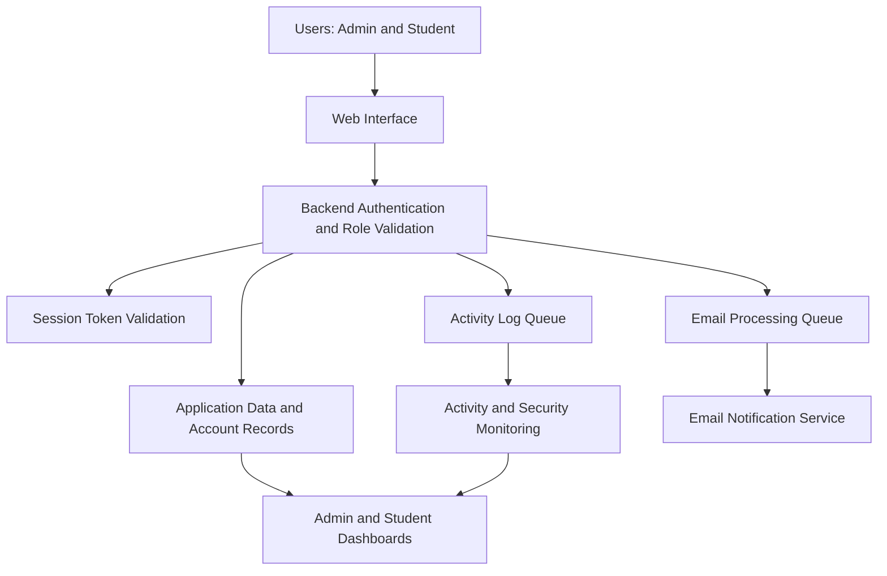

# 🔐 Secure Academic Portal

### Secure Role-Based Academic Management Portal

**A security-focused academic platform for student resources, administrative oversight, session control, automated notifications, and activity analytics.**

  <a href="https://secure-academic-portal.vercel.app/"><strong>🌐 Open Live Portal</strong></a>
  &nbsp;•&nbsp;
  <a href="#-features-at-a-glance"><strong>Explore Features</strong></a>
  &nbsp;•&nbsp;
  <a href="#-system-architecture"><strong>System Architecture</strong></a>

**Created by Ajay Chauhan**  
*BCA — Data Science & Artificial Intelligence · Babu Banarasi Das University (BBDU)*

---

## 📌 Table of Contents

- [Overview](#-overview)
- [The Problem](#-the-problem)
- [Features at a Glance](#-features-at-a-glance)
- [System Architecture](#-system-architecture)
- [Authentication and Session Lifecycle](#-authentication-and-session-lifecycle)
- [Email Automation and Queue Processing](#-email-automation-and-queue-processing)
- [Admin Dashboard and Analytics](#-admin-dashboard-and-analytics)
- [Student Dashboard](#-student-dashboard)
- [Technology Snapshot](#-technology-snapshot)
- [Security Considerations](#-security-considerations)
- [Live Deployment](#-live-deployment)
- [Planned Enhancements](#-planned-enhancements)
- [Project Information](#-project-information)

---

## 🔎 Overview

The **Secure Role-Based Academic Management Portal** is a web-based academic platform built to bring student learning resources and administrative monitoring into one place.

The portal separates access for **Admin** and **Student** roles. Its current feature set combines academic-resource access with backend role validation, SHA-256-based password hashing, account-lock protection, session-token validation, automated email workflows, queue-based processing, and dashboard analytics.

The project was presented at **IBM Day** at Babu Banarasi Das University (BBDU).

> **Project focus:** Secure access · Academic resource management · Reliable background processing · Administrative visibility

## 🎯 The Problem

When academic information is spread across separate workflows, students may struggle to find resources and deadlines, while administrators have limited visibility into account status and security-related activity.

This project addresses the need for:

- A centralized place for assignments, notes, previous-year questions, announcements, and deadlines.
- Clear separation between administrative and student permissions.
- Visibility into account status and failed-login activity.
- Automated registration, password-reset, and security-summary email workflows.
- More reliable handling of email and activity-log tasks when multiple users perform actions concurrently.

## ✨ Features at a Glance

<table>
  <tr>
    <td width="50%" valign="top">
      <h3>🛡️ Security & Access</h3>
      <ul>
        <li>Separate Admin and Student experiences</li>
        <li>Backend role and session-token validation</li>
        <li>SHA-256-based double-hash workflow</li>
        <li>Account lock after five consecutive failed login attempts</li>
        <li>Session-token lifetime of one hour</li>
        <li>Cache-based password-reset request limit</li>
      </ul>
    </td>
    <td width="50%" valign="top">
      <h3>📊 Administrative Insights</h3>
      <ul>
        <li>Total, active, locked, and blocked account indicators</li>
        <li>Failed-login monitoring and login-growth comparison</li>
        <li>Line chart and donut chart</li>
        <li>Student details and account controls</li>
        <li>Activity, academic activity, and email-send logs</li>
        <li>Content upload and batch-wise notifications</li>
      </ul>
    </td>
  </tr>
  <tr>
    <td width="50%" valign="top">
      <h3>🎓 Student Resources</h3>
      <ul>
        <li>Assignment overview and status indicators</li>
        <li>Pending and expired assignment tracking</li>
        <li>Notes and previous-year questions (PYQs)</li>
        <li>Latest announcements</li>
        <li>Upcoming deadline visibility</li>
        <li>Academic resource progress panel</li>
      </ul>
    </td>
    <td width="50%" valign="top">
      <h3>✉️ Automation & Reliability</h3>
      <ul>
        <li>Student welcome email after registration</li>
        <li>Admin new-registration alert</li>
        <li>Email-based password recovery</li>
        <li>Weekly security summary</li>
        <li>Batch-specific content notifications</li>
        <li>Queue-based email and activity-log processing</li>
      </ul>
    </td>
  </tr>
</table>

## 🏗️ System Architecture

The portal can be viewed as three logical layers. This high-level diagram describes responsibilities without assuming a particular database vendor, backend framework, cache product, or queue provider.

### Architecture principles

- **Role separation:** Admin and Student workflows have different permissions.
- **Backend enforcement:** Frontend navigation alone does not grant authorization; protected requests are validated on the backend.
- **Session awareness:** Protected operations depend on a valid session token and role.
- **Operational visibility:** Account and activity indicators are surfaced in the admin dashboard.
- **Queued work:** Email and activity-log tasks use queue-based processing to help handle concurrent actions consistently.

## 🔐 Authentication and Session Lifecycle

### Login and account protection

1. A student registers using the required details, including roll number, name, batch, email, and password.
2. The password is processed through the project's SHA-256-based hashing flow, which uses a double-hash comparison/storage mechanism.
3. During login, the submitted password is processed and compared with the stored value.
4. Five consecutive failed login attempts trigger account-lock protection.
5. Password recovery is initiated through the registered email address using a reset link.
6. Password-reset requests are limited to **one request per account per day** through a cache-based control.

### Session-token lifecycle

- A session token is generated after successful login.
- The token is required for protected backend requests and has a configured lifetime of **one hour**.
- The backend validates the token and role before permitting protected operations.
- A subsequent login replaces the previously stored token with a newly generated token, supporting one active stored token per user.
- When the token expires, protected access is denied and the interface should return the user to login.

### Backend authorization

Opening or editing an admin page in the browser is not intended to grant admin privileges. The backend must validate both the session token and the role associated with the request before returning protected data or performing a privileged action.

### Password-reset safeguards

The design includes backend-side device/session validation for reset-link use and a cache-based limit on reset requests. These controls are intended to reduce link misuse and repeated reset requests.

> **Session note:** If a token remains valid after logout until its expiry time, immediate revocation is not guaranteed. For stronger logout behaviour, explicitly invalidate the server-side token when the user logs out and verify this behaviour in the deployed implementation.

## ✉️ Email Automation and Queue Processing

### Automated email workflows

| Event | Notification or action |
|---|---|
| First student registration | Welcome email to the student |
| New student registration | Registration alert to the admin |
| Password reset request | Reset email sent to the registered address |
| Weekly scheduled summary | Security activity summary, based on configured events |
| New academic content upload | Notification to students in the relevant batch |

### Why queue-based processing?

Multiple students may register, request password resets, or perform other actions at approximately the same time. Queue-based processing separates the incoming request from background work and helps reduce conflicting writes or overwritten event data.

- Email tasks are queued for processing.
- Activity-log events are queued to help preserve event records during concurrent use.
- Background processing improves operational consistency and makes failures easier to inspect.

A queue alone **does not guarantee that every email reaches its recipient**. A production deployment should also consider retries, delivery-failure handling, monitoring, and duplicate-event protection.

## 📊 Admin Dashboard and Analytics

The admin dashboard combines account indicators with activity and security monitoring.

| Dashboard area | Purpose |
|---|---|
| Account status | Displays total, active, locked, and blocked accounts |
| Login monitoring | Tracks failed logins and login-growth trends |
| Line chart | Visualizes login activity across the available reporting period |
| Donut chart | Shows account-status distribution |
| Activity logs | Supports review of relevant user and security events |
| Email-send logs | Provides visibility into email-send activity |
| Account management | Supports configured block/unblock and password-reset actions |
| Content upload | Publishes academic materials and triggers relevant notifications |

The charts support administrative awareness and data-informed decisions. Their accuracy depends on the underlying event data and aggregation logic.

## 🎓 Student Dashboard

The student dashboard presents commonly used academic resources in one place:

- **Assignments:** overview with pending and expired status indicators.
- **Notes:** access to uploaded study materials.
- **PYQs:** access to previous-year question resources.
- **Announcements:** latest news and notice content.
- **Upcoming deadlines:** visibility into assignment due dates.
- **Subject/resource progress:** a summary of academic items currently listed by the portal.

> **Progress-panel clarification:** The current panel reflects available academic items. It should not be interpreted as marks-based performance or assignment-completion progress unless those statuses are explicitly tracked by the implementation.

## 🧰 Technology Snapshot

| Area | Current implementation / known detail |
|---|---|
| Application | Web-based academic management portal |
| Deployment | Vercel |
| Authentication | Password-based login with backend role validation |
| Password handling | SHA-256-based hashing with a double-hash flow |
| Session management | Backend-validated token with a one-hour lifetime |
| Reset-request control | Cache-based, account-level limit of one request per day |
| Background work | Queue-based email and activity-log processing |
| Analytics | Admin dashboard with line and donut charts |

The exact frontend framework, backend framework, database engine, cache product, email provider, and queue implementation are not confirmed in this project description. Add their actual names from the source code and deployment configuration before using this README as a technical handover.

## 🛡️ Security Considerations

The project includes useful access and account-protection controls, but these do not replace a full security review.

- **SHA-256 is a fast, general-purpose hash function.** For production password storage, prefer a password-hashing algorithm such as Argon2id, bcrypt, or scrypt with appropriate salts and parameters.
- Validate privileged operations on the backend; hiding a page or button in the frontend is not authorization.
- Use HTTPS and keep secrets, reset tokens, and session tokens out of source control and screenshots.
- Verify reset-token expiry, single-use behaviour, device/session checks, and cache expiry in the deployed implementation.
- Consider explicit server-side token invalidation on logout, request throttling for authentication endpoints, secure cookie/storage settings, and audit-log retention.
- Never publish real student emails, roll numbers, account details, or security logs in a public repository.

## 🌐 Live Deployment

### [Open the Secure Academic Portal](https://academicportal2.vercel.app/)

**Deployment platform:** Vercel  
**Live URL:** <https://secure-academic-portal.vercel.app/>

For demonstrations, use test accounts and non-sensitive sample data. Vercel hosts the deployed application, but deployment on Vercel alone does not identify where the database, cache, email provider, or persistent files are stored.

## 🚀 Planned Enhancements

The following items are **future plans**, not current capabilities unless separately implemented and verified.

### 1. 📍 Location-based smart attendance

- Admin selects the subject and batch, then enables attendance for a **10-minute window**.
- Date and time are generated by the system.
- Students can mark attendance but cannot edit backend-generated attendance details.
- Attendance is permitted only within a **100-metre radius** of the configured admin location, subject to reliable location verification.

### 2. 🤖 AI-powered student assistance

- Integrate a ChatGPT-compatible API for academic questions and topic explanations.
- Provide assignment-planning and draft-support features with clear academic-integrity guidance.
- Keep API credentials on the backend and apply request limits and cost controls.

### 3. 👩‍🏫 Teacher role and granular permissions

- Add a dedicated teacher role.
- Restrict teachers to assigned subjects and batches.
- Allow authorized teachers to upload assignments and notes and review relevant student activity.
- Keep unrelated batch data and administrator-only controls inaccessible.

### 4. ⚙️ Further hardening and operations

- Adopt a password-specific hashing algorithm.
- Add stronger rate limiting and suspicious-activity alerts.
- Improve queue retries, monitoring, and failed-job handling.
- Expand automated tests for role permissions, session expiry, reset-link security, and concurrent requests.

## 👤 Project Information

| Field | Details |
|---|---|
| Project | Secure Role-Based Academic Management Portal |
| Presenter | Ajay Chauhan |
| Course | BCA — Data Science & Artificial Intelligence |
| Institution | Babu Banarasi Das University (BBDU) |
| Presentation | IBM Day |
| Live deployment | [academicportal2.vercel.app](https://secure-academic-portal.vercel.app/) |

---

**Secure access. Clear visibility. Better academic workflows.**

*An academic project focused on backend authorization, session management, operational reliability, and future extensibility.*

